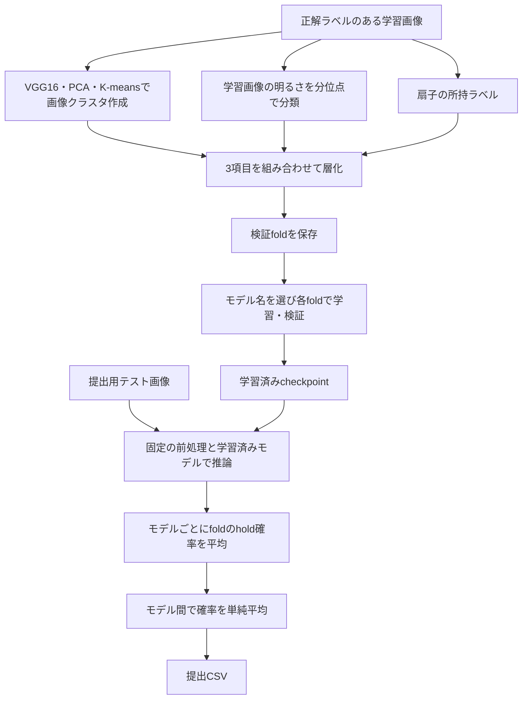

# 扇子の所持を判定する画像分類

## 課題と設計方針

日本舞踊の画像から、人物が扇子を持っている `hold` と、持っていない `not-hold` を判定する。背景にも扇子が写り、人物や扇子の一部が見切れる場合がある。そのため、画像内に扇子が存在するかだけでは判断できず、人物と扇子の関係を捉える必要がある。

このリポジトリでは、画像の縦横比を保つ前処理、撮影条件の偏りを考慮した検証用分割、EVA/EVA02による分類、複数モデルの予測平均を組み合わせる。モデル名を選ぶと、モデル本体・入力サイズ・学習の既定値が対応して設定される。

**提出用テスト画像を使うのは、学習済みモデルによる推論だけである。** 以下の特徴抽出、クラスタリング、明るさの区切り値の計算、学習・検証は、正解ラベルがある学習画像を対象とする。実行コマンドと入力形式は[再現手順](reproduction.md)にまとめている。

## 画像の形を保つ前処理

元画像を正方形に引き伸ばすと、人物や扇子の形が変わる。そこで、長辺をモデルの入力サイズまでリサイズし、短辺を黒で埋めることで縦横比を維持する。

```text
RGB画像
  → 学習時のみデータ拡張
  → 長辺を image_size にリサイズ
  → image_size × image_size になるまで中央配置で黒い余白を追加
  → 設定に保存したモデル別の平均・標準偏差で正規化
  → Tensorへ変換
```

正規化には、固定バージョンのtimmがモデルごとに定義するmean/stdを使用し、checkpointにも保存する。推論ではcheckpointの値を復元する。正規化の記録がないcheckpointにはImageNetの平均 `(0.485, 0.456, 0.406)`、標準偏差 `(0.229, 0.224, 0.225)` を適用する。[モデル別の設定と比較方法](evaluation.md)

学習時は左右反転、ガンマ補正による明るさの変化、平行移動・拡大縮小・回転を組み合わせる。上下反転の有無や適用確率はモデルごとの設定として管理する。画像はデータ拡張まで0〜255の `uint8` で扱い、正規化で浮動小数点へ変換する。

検証・推論ではランダムな拡張を行わず、同じ前処理を使用する。実装は[transforms.py](../src/fan_classifier/transforms.py)、モデルごとの設定は[registry.py](../src/fan_classifier/registry.py)にある。

## 正解ラベル・画像の見た目・明るさによるTriple Stratified分割

交差検証では、学習画像を複数のグループ（fold）に分け、1つを検証に、残りを学習に使う。正解ラベルだけを揃えても、明るい画像や特定の背景が一部のfoldへ偏る可能性がある。そこで、次の3項目を組み合わせたカテゴリごとに、各foldへ画像を配分する。

| 項目 | 変数名 | 作成方法 |
| --- | --- | --- |
| 扇子の所持 | `holding_label` | 親フォルダが `hold` なら1、`not-hold` なら0 |
| 画像の見た目のグループ | `scene_cluster` | VGG16の特徴をPCAで圧縮し、K-meansでクラスタリング |
| 明るさのカテゴリ | `brightness_bin` | 学習画像の平均画素値を、画像数がほぼ均等になる区切り値で分類 |

例えば「扇子を持つ・クラスタ2・明るさカテゴリ1」を1つの層化カテゴリとする。これを `stratification_label` に保存し、`StratifiedKFold` でカテゴリの比率をfold間で保つように分割する。3項目を組み合わせるため、ここではTriple Stratifiedと呼ぶ。

### 画像特徴から見た目のグループを作る

ImageNetで事前学習されたKerasのVGG16を、分類層を除いた `include_top=False` で使用する。入力を224×224へリサイズし、出力の7×7×512を25,088次元へ平坦化する。この特徴をPCAで既定50次元に圧縮し、K-meansで既定3クラスタへ分ける。

`scene_cluster` は撮影場所の偏りを捉えるための代理指標である。見た目で分けたグループであり、実際の撮影場所と一致することを確認したラベルではない。VGG16は分割の準備に使い、後述のEVA/EVA02分類器へ特徴量やクラスタ番号を追加入力することはない。

実行条件を揃えるため、画像は名前順に読み込み、クラスタリング用seedの既定値を42とする。PCAは `svd_solver="randomized"`、K-meansは `n_init=10` を指定する。OpenCVで読み込んだBGR画像はRGBへ変換してから、Kerasの `preprocess_input` を適用する。

特徴抽出はバッチ単位で行い、特徴量をNumPyのメモリマップへ順に保存する。画像IDと特徴量の行順を固定し、クラスタと正解ラベルの対応を保つ。ただし、PCAは全特徴行列と作業用メモリを使う。float32の特徴行列だけでも、画像数×25,088×4バイトの保存領域が必要になる。実装は[features.py](../src/fan_classifier/features.py)と[stratification.py](../src/fan_classifier/stratification.py)にある。

### 学習画像の実測値から明るさを分類する

画像ごとに、リサイズ前の全画素・全RGBチャンネルの平均を `brightness_mean` として求める。値域は0〜255である。

`--brightness-bins x` を指定すると、**学習画像全体の実測分布の分位点**を使って、各カテゴリの画像数がほぼ均等になる境界を求める。既定の3分類では1/3・2/3分位点が境界になる。計算にはNumPyの `quantile(method="linear")` を使い、`--brightness-thresholds` で区切り値を直接指定することもできる。

区切り値と同じ明るさは上側のカテゴリへ入れる。同じ明るさの画像は分けないため、同値が多いと件数が偏る場合がある。分位点が重複する場合や空のカテゴリが生じる場合は停止し、分類数を自動で減らさない。

### 分割を保存し、学習時に検証する

`prepare-strata` は、以上の処理をまとめて実行する。[preparation.py](../src/fan_classifier/preparation.py)が作成する `train_strata.csv` には、画像ID、正解ラベル、画像クラスタ、明るさ、層化カテゴリに加え、検証foldを示す `fold_index`、分割seedの `split_seed`、fold数の `split_count` が保存される。学習時はこれらと指定した設定の一致を確認し、保存済みの割当を使用する。

クラスタリング用seedとfold分割用seedは分けて管理する。分割用seed・fold数は選択モデルの設定から取得し、必要に応じて上書きできる。異なるモデルのfoldを準備する際は、生成済みの `train_strata.csv` を `--clusters-csv` へ渡して画像クラスタを再利用できる。この場合も画像IDの一致を確認し、明るさは学習画像から計算し直す。

`summary.json` には、明るさの区切り値、分類方法、参照した学習画像数、全体とfoldごとの件数、クラスタリング条件を記録する。データに由来するCSV・特徴量・集計結果は公開対象に含めない。

分割で観測された各層化カテゴリには、fold数以上の画像が必要である。件数が足りない場合は対象カテゴリと件数を示して停止し、カテゴリを勝手に統合したり、正解ラベルだけの分割へ切り替えたりしない。

### この検証設計で評価できる範囲

特徴抽出・PCA・K-meansと明るさの分位点計算には、分割前の学習画像全体を使う。目的は、各foldの条件分布を揃えることである。提出用テスト画像は入力しない。

層化だけでは、同一人物・動画・撮影場所が学習と検証にまたがることを防げない。そのため、未知の人物や撮影場所への汎化を、この分割だけで評価できるとは主張しない。撮影単位で独立した評価が必要な場合は、同じ人物や撮影単位を1つのグループにまとめるgroup分割を別途検討する必要がある。

## 背景の扇子への依存を減らす検討

背景の扇子を誤判定の手がかりにしないよう、学習画像から背景の扇子を削除する方法と、画像の余白へ扇子を追加する方法を試した。削除では手に持った扇子まで消えてしまい、評価が悪化した。余白への追加でも改善が見られなかったため、どちらも採用していない。

現在の学習・推論コードには、扇子そのものを追加・削除する処理を含めていない。提出用テスト画像にもこの加工は行わない。試行の狙いと判断は[実験記録](experiments.md#背景の扇子を追加削除する試行)にまとめている。

## モデル名で選択できる6種類の分類器

EVA/EVA02の事前学習モデルを使用し、分類ヘッドを2出力へ変更する。`build_model(model_name)` に次の選択名または完全なtimmモデル識別子を渡すと、対応するモデルを生成できる。

| 選択名 | timmモデル識別子 | 入力サイズ |
| --- | --- | ---: |
| `eva02_large_448` | `eva02_large_patch14_448.mim_m38m_ft_in22k_in1k` | 448 |
| `eva_giant_560` | `eva_giant_patch14_560.m30m_ft_in22k_in1k` | 560 |
| `eva_giant_336` | `eva_giant_patch14_336.m30m_ft_in22k_in1k` | 336 |
| `eva_large_336` | `eva_large_patch14_336.in22k_ft_in22k_in1k` | 336 |
| `eva_giant_clip_224` | `eva_giant_patch14_224.clip_ft_in1k` | 224 |
| `eva_large_196` | `eva_large_patch14_196.in22k_ft_in22k_in1k` | 196 |

入力サイズ・fold数・学習率・バッチサイズなどを[registry.py](../src/fan_classifier/registry.py)で一元管理する。分類のclass 0は `not-hold`、class 1は `hold` とし、class 1の確率を `holding_probability` として出力する。

## 学習・推論・アンサンブル

各foldの学習にはCrossEntropyLoss、AdamW、CosineAnnealingLRを使用する。CUDAではAMP（混合精度演算）を利用する。検証では評価モードへ切り替え、loss・accuracy・F1を記録し、設定した指標で最良のcheckpointを保存する。checkpointには重みとともにモデル名や前処理・学習条件を保存し、推論時に対応を確認する。



6モデルを同じ重みで平均する場合は、まず各モデル内のfold予測を平均する。その後、モデル単位の確率CSVを1つずつ渡し、モデル間で単純平均を取る。この順序により、fold数が異なってもモデルごとの重みが等しくなる。

確率を平均する前に画像IDを照合し、欠損・重複・異なる画像集合がある入力は拒否する。最終的に `holding_probability > 0.5` なら `holding_label=1`、それ以外は0とする。実装は[engine.py](../src/fan_classifier/engine.py)と[prediction.py](../src/fan_classifier/prediction.py)にある。

## 実装で重視した点

| 設計 | 目的・確認すること |
| --- | --- |
| モデル登録情報・設定・学習器を分離 | モデルを切り替えても同じ学習・推論手順を使える |
| 変数名で役割を明示 | 正解ラベル、層化カテゴリ、検証fold番号を区別する |
| 分割をCSVへ保存 | 学習時に割当を再利用し、seed・fold数の不一致を検出する |
| 実行設定と環境情報を保存 | 学習率・前処理・依存ライブラリなどの実行条件を確認できる |
| 評価モードと固定の推論前処理 | 検証・推論に学習専用のランダム処理を入れない |
| checkpointの設定と入力を検証 | 別モデルや異なる学習条件の重みの混在を検出する |
| 画像IDに基づく予測の平均 | CSVの行順による取り違えを防ぐ |
